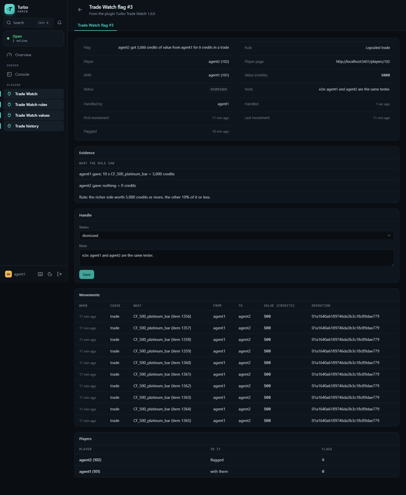
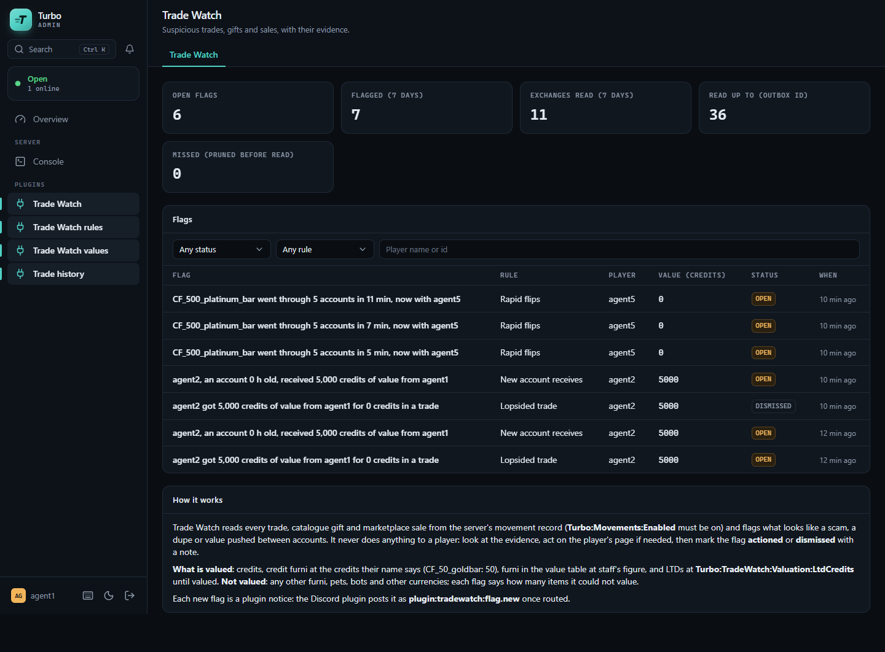
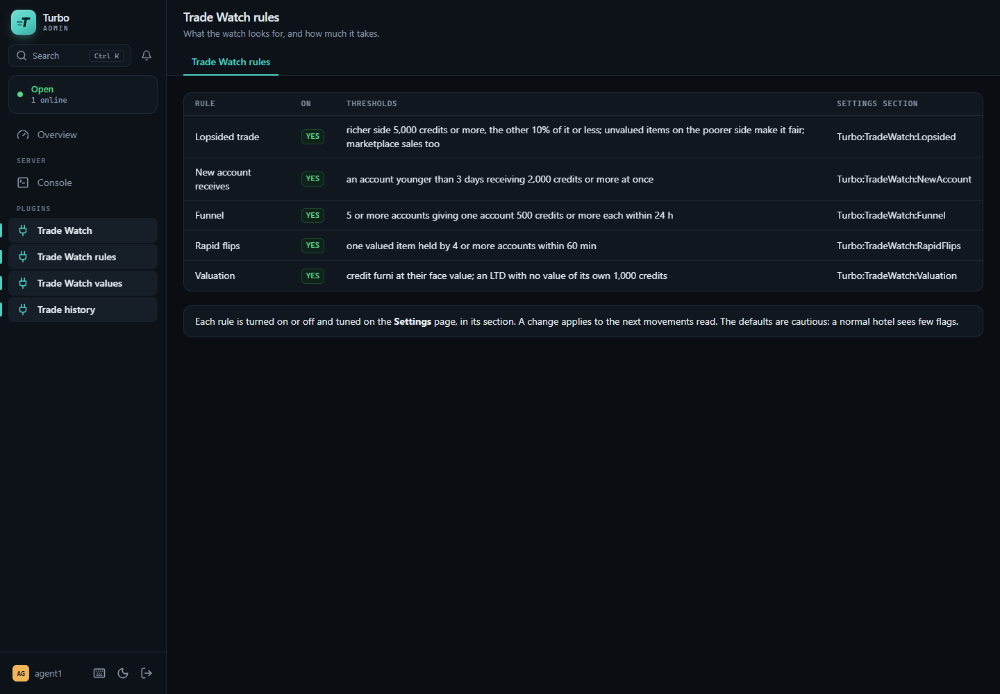
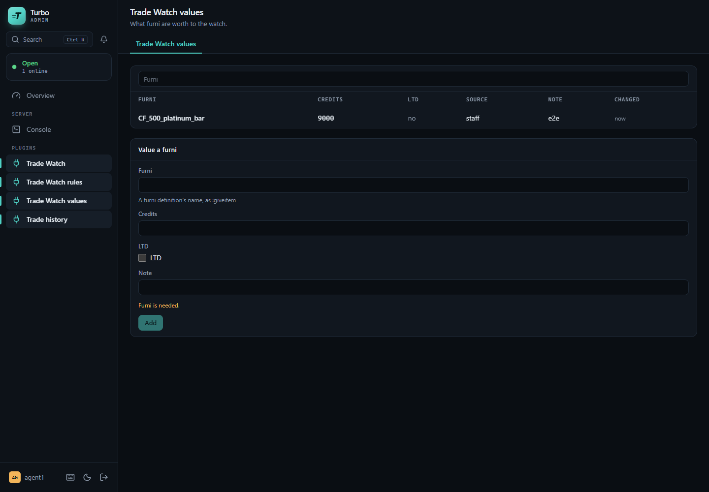
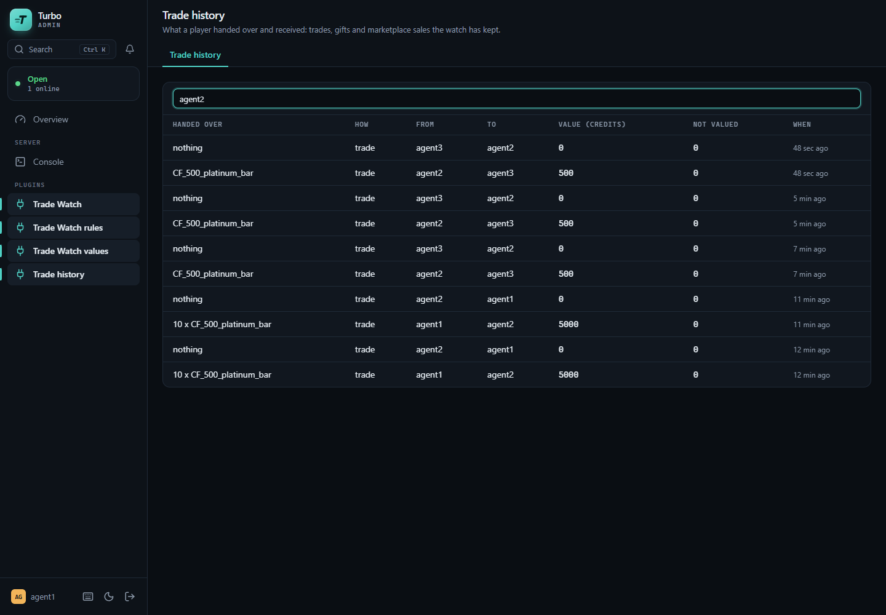

# Turbo Trade Watch plugin

What a retro loses most to is scams, dupes and alt accounts funnelling value into one. Trade Watch
watches every trade, catalogue gift and marketplace sale of a [Turbo](https://github.com/nitrodevco/turbo-cloud)
hotel and flags the suspicious ones for staff, with their evidence.

- **Four rules**, each on or off with its thresholds on the panel's Settings page: a **lopsided**
  trade or sale, a **new account** receiving valuables, a **funnel** (one account fed by many
  within hours) and **rapid flips** (one item through many accounts within minutes).
- **Evidence kept**: each flag holds what the rule saw (who gave what, worth how much, what could
  not be valued), its movements and the players in it, for good.
- **Never acts on a player.** Staff look, act on the player's page if needed, and mark the flag
  actioned or dismissed with a note.
- **Flagged once.** The watch reads the server's movement record with its own cursor, in one
  transaction per batch: a batch delivered again, a hot reload or a restart flags and announces
  nothing twice.
- **Other plugins hear of it**, without this plugin knowing them: the Discord plugin can post each
  new flag.



## What it reads

The server's asset movement record (turbo-cloud `docs/movements.md`), which must be on:
`Turbo:Movements:Enabled` = `true`. The watch registers as a movement consumer (`tradewatch`) and
keeps the movements of three causes:

| Cause | Read as |
| --- | --- |
| `trade` | Each side's items, from the player who offered them to the other. A side that offered nothing is there, worth nothing. A trade whose second half failed (handed back under `compensation`) moved nothing and is skipped. |
| `catalog.gift` | The sender (who paid) to the receiver: the present's content. A gift to oneself is skipped. |
| `market.buy` | The price, buyer to seller, and the item, seller to buyer. A sale makes the item again under a new id; the watch keeps it on the listed item's chain. |

Staff gives, rewards and purchases are not exchanges between players and are not read (the
Discord plugin and the ledger see those). Movements, transfers and hand-overs are kept for
`RetentionDays` (90); flags for good.

## What is valued

| Valued | At |
| --- | --- |
| Credits | Themselves (a marketplace price). |
| Credit furni | The credits their name says: `CF_50_goldbar` 50, `CF_diamond_2500` 2,500 (as core reads them). |
| Furni in the value table | Staff's figure (the Values page): rares, LTDs. |
| LTDs | Learnt by themselves: a furni made with a limited edition's serial joins the value table as an LTD; one with no value of its own counts as `Valuation:LtdCredits` (1,000; 0: not valued). |

**Not valued**: any other furni, pets, bots and currencies other than credits. A gift whose content
has no value is worth the credits paid for it. Every flag says how many items it could not value.

## Rules

| Rule | Flags | Defaults (`Turbo:TradeWatch:<Rule>`) |
| --- | --- | --- |
| Lopsided trade (`Lopsided`) | A trade or marketplace sale where one side is worth `MinValue` or more and the other `MaxReturnPercent` of it or less. Flagged on who gained. | `MinValue` 5,000, `MaxReturnPercent` 10, `UnvaluedIsFair` on (an unvalued item on the poorer side may be a rare not in the table, so the trade is taken as fair), `Marketplace` on |
| New account receives (`NewAccount`) | An account younger than `MaxAgeDays` receiving `MinValue` or more in one trade, gift or sale. | `MaxAgeDays` 3, `MinValue` 2,000 |
| Funnel (`Funnel`) | `MinSenders` or more accounts each giving one account `MinValue` or more within `WindowHours`, net of what they got back in the same trade or sale (a fair trade or a sale at its value feeds no one). One flag while it goes on: later senders add to it. | `MinSenders` 5, `WindowHours` 24, `MinValue` 500 |
| Rapid flips (`RapidFlips`) | One item held by `MinAccounts` or more accounts (the first owner included) within `WindowMinutes`. One flag while it goes on. | `MinAccounts` 4, `WindowMinutes` 60, `ValuedOnly` on |

Windows are measured in when the movements happened, so a backlog read late flags what a live
read would have. Each rule has `Enabled`; the whole watch has `Turbo:TradeWatch:Enabled` (off: the
outbox is not read; turned on again, the watch reads on from where it was, as far as the outbox
still holds). Settings apply to the next movements read.

## Settings

Under `Turbo:TradeWatch` (and its sections), on the panel's Settings page while the plugin is
loaded:

| Setting | Default | |
| --- | --- | --- |
| `Enabled` | `true` | Whether movements are read at all. |
| `NoticeMaxAgeMinutes` | 60 | A flag about something older than this when it is read (the plugin was off or behind) is kept but not announced. |
| `RetentionDays` | 90 | How long the movements, transfers and hand-overs the watch keeps are kept. |
| `Valuation:CreditFurni` | `true` | Whether credit furni count at their face value. |
| `Valuation:LtdCredits` | 1000 | What an LTD with no value of its own counts as. |

## Admin pages and permissions

| Page | |
| --- | --- |
| **Trade Watch** | Open flags, flags in 7 days, exchanges read, how far the watch has read and what it missed (rows pruned before it read them); the flags, by status, rule and player. |
| A flag | The rule's evidence, line by line; status and note (open, actioned, dismissed); its movements; its players, each opening their trade history. |
| **Trade Watch rules** | Each rule, on or off, its thresholds in words and its Settings section. |
| **Trade Watch values** | The value table: add, change, remove; LTDs learnt are listed as such. |
| **Trade history** | A player's trades, gifts and sales (by name or id), with what each was worth. |

`plugin.tradewatch.view` sees the pages; `plugin.tradewatch.manage` handles flags and changes the
value table. No one holds them until the hotel grants them.

## Notices to other plugins

Each new flag is a turbo-cloud `PluginNoticeEvent` (`docs/plugin-notices.md`) from `tradewatch`,
topic `flag.new`, keyed by the flag's id. With the Discord plugin loaded it shows on its routing
table as `plugin:tradewatch:flag.new`, off until the hotel routes it to a webhook. Title
`Lopsided trade: Carol got 5,000 credits of value from Bob for 0 credits in a trade`; fields Rule,
Player, With, Value, Flag; level warning. When the server has `Turbo:Admin:PanelUrl`, it links to
the flag's page. A flag the server stopped before announcing is announced at the next start; one
that only grew (a funnel's new sender) is not announced again.

## Privacy

The plugin keeps player ids, furni and currency movements between players and staff notes; no
address, no chat. Names are looked up when shown (a flag's summary keeps the names it was made
with). Nothing leaves the hotel unless another plugin (Discord) is set to post the notices.

## Tables

`tradewatch_movements` (the exchanges' movements, unique by operation and seq),
`tradewatch_transfers` (who handed whom what in each operation, valued), `tradewatch_handovers`
(each item's hands), `tradewatch_flags`, `tradewatch_values` and `tradewatch_cursor`. No foreign
keys into core. Uninstalling the plugin from the panel drops them.

## Build and install

The plugin builds against a built turbo-cloud checkout (its `Turbo.*` assemblies are the host's and
are never copied into the plugin's folder):

```sh
TURBO_CLOUD=/path/to/turbo-cloud ./scripts/package.sh
```

That leaves `dist/tradewatch/` with `TurboTradeWatch.dll`, `TurboTradeWatch.xml` (the settings'
descriptions on the panel) and `manifest.json`. Copy that folder into the server's plugin folder
(`Turbo:Plugin:PluginFolderPath`, by default `plugins/` beside `Turbo.Main`), as
`plugins/tradewatch/`, turn on `Turbo:Movements:Enabled`, and restart the server (or let hot reload
pick it up). On load the plugin creates its tables through the server's own migrator. Then grant
the panel nodes to the staff who watch trades, and value the hotel's rares on the Values page.

### Releases

A tag `v1.2.3` (pushed, or named in a manual run of Release, which makes it on that commit) runs
`.github/workflows/release.yml`: it builds and tests the plugin against turbo-cloud at the ref
pinned there (`TURBO_CLOUD_REF`), stamps the manifest's `Version` (1.2.3) and `BuiltAgainst` (that
ref), and attaches `tradewatch-v1.2.3.zip` to the tag's release. A server linked to this repository
in the admin panel (Plugins, Link from GitHub) is offered the release and installs the zip.
`ApiVersion` in the manifest is the turbo-cloud plugin API it is built for
(`Turbo.Contracts.Plugins.PluginApi`); move `TURBO_CLOUD_REF` and it together when turbo-cloud
changes that.

## Tests

```sh
dotnet test TurboTradeWatch.Tests -p:TurboCloudPath=/path/to/turbo-cloud
dotnet tool restore && dotnet csharpier check .
```

Each rule's thresholds and windows, what is and is not valued (credit furni, the table, LTDs learnt,
gifts), a compensated trade, a sale keeping an item's chain, a batch delivered twice, a restart
reading on from its cursor, a flag announced once (also after a restart cut it off) and an old one
not at all, gaps, late batches, pruning, and the admin endpoints, over an in-memory SQLite database
and a fake hotel. `.github/workflows/ci.yml` runs both on every push and pull request against
turbo-cloud's `main`.

## Migrations

```sh
TurboCloudPath=/path/to/turbo-cloud DesignTime=true dotnet ef migrations add <Name> \
  --project TurboTradeWatch/TurboTradeWatch.csproj --context TradeWatchDbContext --output-dir Database/Migrations
```

## Not in this version

- A shared IP or machine between trade partners: turbo-cloud does not show staff a player's
  addresses, so the watch does not use them.
- Time online ("under N hours online"): turbo-cloud keeps no total; the new account rule uses the
  account's age.
- A link straight to the player's page: the panel's plugin pages have no link field yet, so a flag
  shows the address as text and opens the plugin's own trade history for each player.

## Screens

| | |
| --- | --- |
|  |  |
|  |  |
